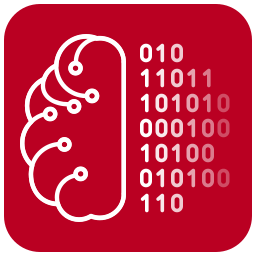

<p align="center">
  
</p>

# brAIn stream

Multi-device recording for the ITU brAIn lab, into a **BIDS** dataset, on
Windows, macOS and Linux:

- **g.tec Unicorn Hybrid Black**: EEG, through [g.Pype](https://gpype.gtec.at)'s
  HybridBlack source;
- **g.tec g.HIamp**: high-density EEG (up to 256 channels, 256–4800 Hz),
  through g.Pype's GHIamp source and g.tec's gtec-gds driver;
- **Gazepoint GP3 and GP3 HD**: eye tracking (60 Hz; the GP3 HD at 150 or
  60 Hz), through [OpenGP3](https://github.com/itubrainlab/opengp3), on this
  computer or on another one over the Open Gaze API. Without one, a webcam
  through OpenGP3's webcam eye tracking: far less accurate (2–5° instead of
  0.5°, no pupil size), and the recordings say so;
- **Polar H10**: ECG, heart rate and RR intervals;
- **Shimmer3 GSR+**: skin conductance and pulse (PPG);
- **LSL streams**: markers from any Lab Streaming Layer stream, as events;
- **Video Stream**: any camera on the computer (a webcam, a capture card),
  as video;
- **Screen Capture**: the screen as OBS Studio captures it, sent over NDI
  (DistroAV plugin) with low latency from this or another computer, as video.

Video is stored as BIDS behavioural video, following the BEP047 proposal
(`beh/…_recording-<label>_video.mp4` and its sidecar, listed in
`.bidsignore` until BEP047 is released), with every frame's time in a
`…_recording-<label>_physio.tsv.gz` beside it.

## Download

Get the package for your system from the
[latest release](https://github.com/itubrainlab/brainstream/releases/latest):

| System | Package | Install |
|---|---|---|
| Windows 10 or 11, 64-bit | `brAInstream-<version>-windows-x86_64.zip` | Unpack it and double-click `install.cmd`; open brAIn stream from the Start menu. |
| macOS 14 or later, Apple Silicon | `brAInstream-<version>-macos-arm64.dmg` | Drag **brAIn stream** to Applications. The first time, right-click it and choose **Open** (the app is not notarized). |
| Linux x86_64, glibc 2.34+ (Ubuntu 22.04, Debian 12, Fedora 35 or later) | `brAInstream-<version>-linux-x86_64.tar.gz` | Unpack it and run `./install.sh`; open brAIn stream from the applications menu or run `brainstream`. |

**Upgrading from brAIn dump** (the name until 0.5): install brAIn stream as
above. Your settings and recent projects move over the first time it starts,
and `.braindump` projects open as they are. The old app stays installed until
you remove it: delete *brAIn dump* from Applications (macOS), run its
`uninstall.cmd` (Windows) or `uninstall.sh` (Linux). On macOS, allow camera
access once more for the new app.

None needs administrator rights. **The first launch needs an internet
connection:** the packages contain their own Python and brAIn stream, but not
g.Pype or g.tec's Unicorn driver, which g.tec's licences do not allow to be
bundled. The first launch downloads them and the other libraries from PyPI,
at the versions the release was tested with.

## Running from source

```bash
python -m venv .venv && .venv/bin/pip install -e ".[test,shimmer]"
.venv/bin/brainstream              # choose or create a project
.venv/bin/brainstream --simulate   # no hardware
.venv/bin/python -m pytest -n 4 -m "not slow"   # the quick tests, about 15 s
.venv/bin/python -m pytest -n 4  # all of them, about 40 s; BIDS_VALIDATOR=.venv/bin/bids-validator-deno to validate too
```

`shimmer` installs pyshimmer (GPL-3.0), which the Shimmer3 GSR+ needs; the
rest of brAIn stream does without it.

- **Projects** (`<name>.brainstream`): the devices, each one's configuration
  (saved as you change it), the BIDS output folder, the default task and the
  authors. The app opens on a project picker.
- **UI**: a toolbar over each device's viewer, plus a left column listing the
  project's devices and the supported ones (add with +, remove with ×).
- **Unicorn recording filters**: a high-pass, a low-pass and a notch, chosen
  in the Settings from Unicorn Recorder's filters (by default a 0.1 Hz
  high-pass and no low-pass, i.e. half the sampling rate). They are applied
  to the recorded EEG and described in `eeg.json` (`SoftwareFilters`) and
  `channels.tsv`. The Filter and Notch boxes above the viewer only change
  what is shown.
- **g.HIamp recording filters**: the amplifier's own band-pass and notch,
  chosen in the Settings from those g.tec's driver lists for the sampling
  rate (**Load from amplifier**, or listed as it connects). The first time
  a rate's filters are loaded, the band-pass is set to the amplifier's
  0.1 Hz high-pass (no low-pass). They are described in `eeg.json`
  (`HardwareFilters`) and `channels.tsv`; the Filter and Notch boxes above
  the viewer only change what is shown.
- **GP3**: an eye view (camera image locally, pupil positions remotely),
  distance feedback, calibration (5/9/13/16/25 points, full-screen targets
  here or on the tracker computer), validation (local), and a plot of the
  calibration quality. On this computer, the tracker is the GP3 (or GP3 HD)
  or, when chosen, a webcam: brAIn stream never falls back to one by itself.
  A webcam's warning, or a remote OpenGP3's, shows on the page and goes
  into the recording's `TrackerSetup`.
- **Polar H10** (Bluetooth LE, via bleak): the raw ECG at 130 Hz, optionally
  the accelerometer, and the heart rate with every RR interval. BIDS physio
  `recording-ecg` (`cardiac`, µV) and `recording-accel`, with each beat in
  `recording-ecg_physioevents`.
- **LSL streams**: any Lab Streaming Layer streams, picked by name, type or
  source id (or from a list of the streams on the network), found whenever
  they appear. Every sample they send while recording becomes an event
  (`trial_type` = stream name, `value` = sample) in the run's `_events.tsv`,
  merged with the EEG's triggers and timed from the EEG's first sample.
- **Record** asks for the participant, session, task and run, then writes
  `eeg/*_eeg.bdf` (+ json/channels/events) and the eye tracking as BIDS
  eye-tracking physio under `beh/` (`recording-eye1|eye2|gaze`, plus
  physioevents and the run's events with `StimulusPresentation`), with each
  file's start time in `scans.tsv`.

## Architecture: one g.Pype pipeline

The whole recording runs in one [g.Pype](https://gpype.gtec.at) 4.2 pipeline
(`brainstream.pipeline`):

- **Every device is a g.Pype input.** The EEG amplifiers are g.Pype's own
  sources (HybridBlack for the Unicorn, GHIamp for the g.HIamp); the eye
  tracker, the Polar strap, the Shimmer, the LSL streams and the videos
  are `PushSource`s, fed by the device's own thread, one row per sample
  (a frame's time and number, for video; a marker's time and code, for
  LSL). The amplifier, when there is one, owns the pipeline's master
  timeline.
- **The BIDS output is g.Pype sinks.** Each device's files are written by
  `BidsWriter`s, g.Pype file writers whose recordings begin and end on two
  g.Pype actions, `begin` and `end`, which **Record** invokes through
  `Pipeline.invoke_action`: BDF for EEG, gzipped TSV for physio and eye
  tracking, MP4 for video. Channels are named and chosen with g.Pype's
  ChannelLabeler and ChannelSelector, and the EEG's recording filters are
  g.Pype GenericFilters.
- **Connecting** a device builds its nodes into the pipeline. A running
  g.Pype pipeline cannot gain or lose nodes, so connecting or
  disconnecting one device restarts the pipeline (not while recording),
  and **Connect all** starts it once with every device. When one device
  fails, the pipeline stops, and with it every device.

The data viewers' taps and the live-swappable view filters are brAIn
dump's own g.Pype nodes (g.Pype's filters can be bypassed while running,
but not retuned); the simulated Unicorn is g.Pype's HybridBlack on a
stand-in for its driver.

## Synchronisation

Every device is time-stamped on one monotonic clock of the recording
computer. The EEG's first-sample time and its real sampling rate are
measured from every sample's acquisition time (`RecordingTiming` in
`_eeg.json`), and event onsets and `StartTime`s are given in the EEG's own
time through that rate, so they stay on the right EEG sample even as the
headset's clock drifts. g.Pype gives each stream its own sample grid, so
how the grids line up is measured on top of it: every source keeps each
sample's acquisition time (the amplifiers' corrected for Bluetooth bursts
and the link's delay, which is also the time g.Pype places triggers by).
A test sends a UDP trigger (placed by g.Pype) and an LSL marker (placed
by brAIn stream) at the same instant and checks they land on the same EEG
sample.

## Validating a setup

[`validation/`](validation/README.md) has a 10-minute procedure, in
PsychoPy with LSL markers, and an analysis that checks a recording: EEG
alpha with the eyes closed vs open, gaze accuracy, the N170 to faces, and
the synchronisation of EEG, markers, eyes and the screen (OBS).

## Devices by system

| | Windows | macOS | Linux |
|---|---|---|---|
| Unicorn | pair it first | found over Bluetooth | found over Bluetooth |
| g.HIamp | USB, gtec-gds driver | USB, gtec-gds driver | USB, gtec-gds driver |
| GP3 / GP3 HD, this computer | [UsbDk](https://github.com/daynix/UsbDk/releases), installed once (or WinUSB via [Zadig](https://zadig.akeo.ie)) | nothing | a USB rule, installed once (asks for the password) |
| GP3 / GP3 HD, remote | nothing | nothing | nothing |
| Webcam eye tracking | nothing (downloads a 4 MB face model once) | camera access, asked once | nothing (V4L2) |
| Polar H10 | Bluetooth LE | Bluetooth LE | Bluetooth LE (BlueZ) |
| Shimmer3 GSR+ | pair it; its outgoing COM port | pair it; `/dev/cu.Shimmer3-…` | pair it and `rfcomm bind`; `/dev/rfcomm0` |
| LSL | nothing | nothing | nothing |
| Video Stream | nothing | camera access, asked once | nothing (V4L2) |
| OBS over NDI | DistroAV plugin in OBS | DistroAV plugin in OBS | DistroAV plugin in OBS |

g.tec's Unicorn driver has builds for Windows x64, Linux x86_64 and Apple
Silicon Macs only.

## Packages and releases

`packaging/` builds the three packages (each needs uv, git and the
project's `.venv`; the Linux and Windows ones build on macOS or Linux):

```bash
packaging/macos/build_app.sh          # dist/brAInstream-<version>-macos-arm64.dmg
packaging/linux/build_linux.sh        # dist/brAInstream-<version>-linux-x86_64.tar.gz
packaging/windows/build_windows.sh    # dist/brAInstream-<version>-windows-x86_64.zip
```

Every push and pull request runs the [Check](.github/workflows/check.yml)
workflow: the quick tests, on Linux. The tests marked `slow`, which record
through the simulated devices, run only in the
[Release](.github/workflows/build.yml) workflow, started by a `v*` tag (or by
hand from the Actions tab). It runs every test on all three systems while it
builds the packages, installs each on its own system and runs
[packaging/smoke_test.py](packaging/smoke_test.py) with every device
simulated. It publishes only when all of them pass. To release: write `docs/releases/v<version>.md`, set
`__version__` in `src/brainstream/__init__.py`, commit, and push a
`v<version>` tag.

## Licence

brAIn stream is MIT licensed; see [LICENSE](LICENSE). It runs on g.Pype, under
the **g.tec Non-Commercial License**: free for academic research and teaching
with a g.tec amplifier; read it before use. The Shimmer's driver, pyshimmer,
is GPL-3.0 and optional.
